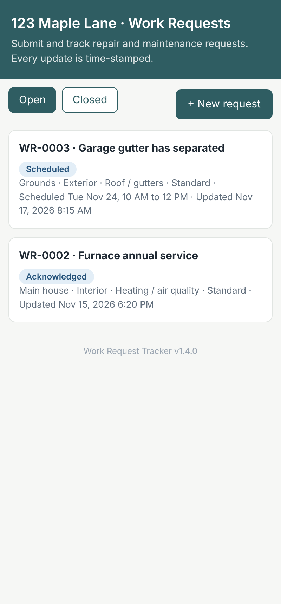
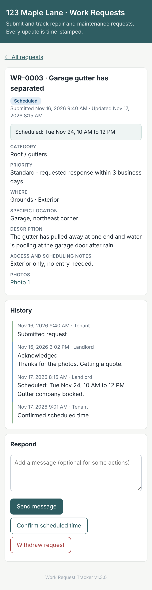
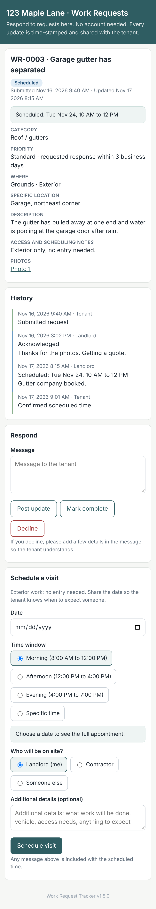
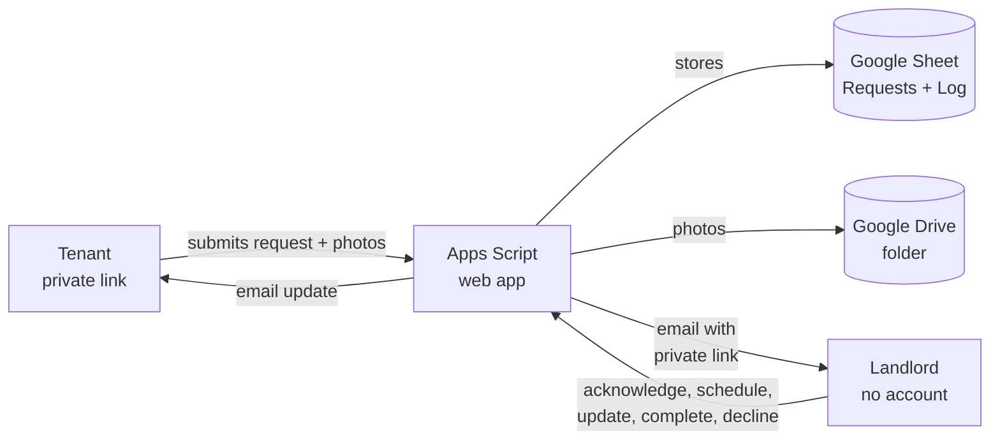
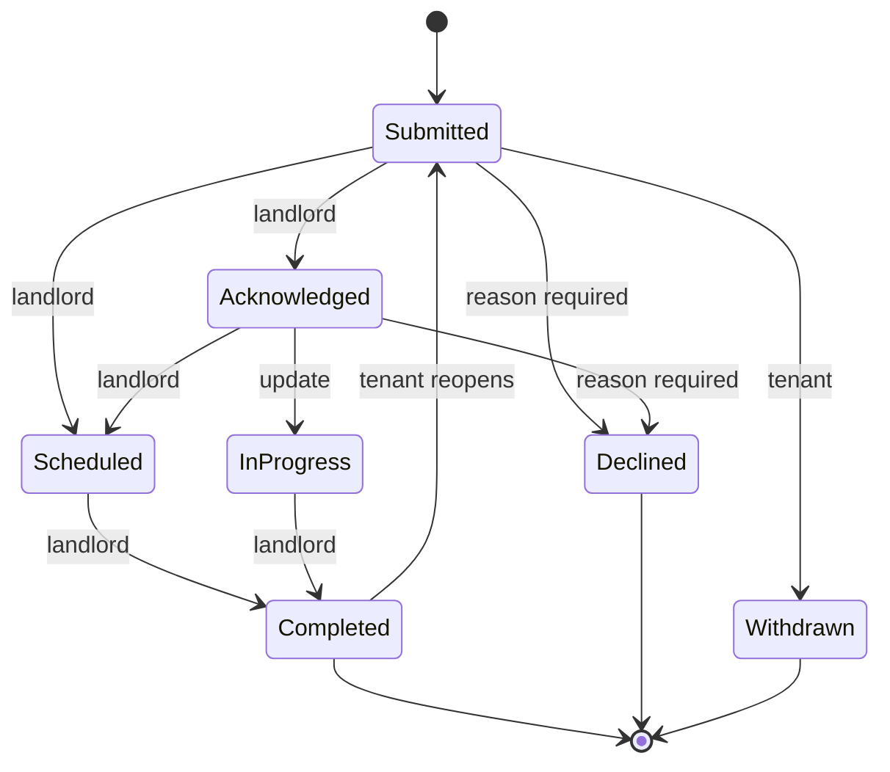
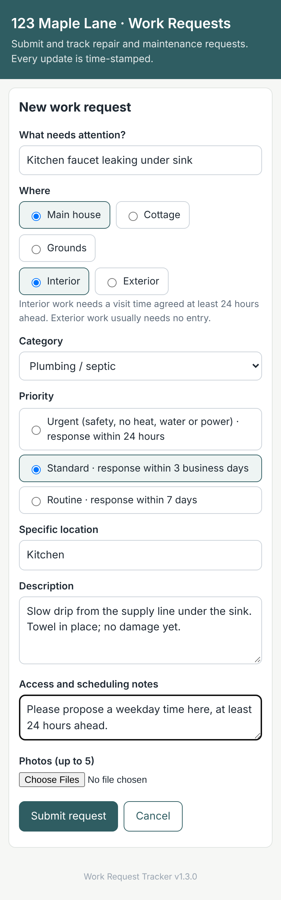
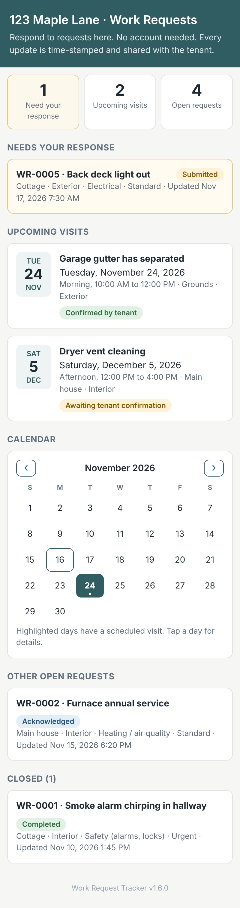

# Work Request Tracker

**A no-login repair request workflow for tenants and landlords, built on Google Apps Script.**

The tenant submits requests from a private page. The landlord gets an email with a private link and responds in one click: acknowledge, schedule, update, complete, or decline with a reason. Every step is time-stamped in one shared record. It's hosted by Google, free to run, and can be reused for any property, client or vendor.

  
  
  

## The problem

A long-term tenant and a small, independent landlord had good intentions, but no system. Repair requests happened in person and by text, and they scattered quickly:

- Requests were easy to forget, and it was hard to tell what was promised and when.
- Text threads mixed repairs with rent, scheduling and everything else, which made conversations tense.
- There was no single record both sides agreed on.

The goal was a **calm, predictable process**: one place to ask, one place to answer, and a record that speaks for itself.

## Constraints that shaped the design

| Constraint | Design decision |
| --- | --- |
| The landlord would not create an account or learn new software | Each request email carries a private per-request link. One click opens a page with five clearly labeled buttons. No login. |
| Communication needed boundaries | Every exchange happens on the request itself, by design. Emails ask both parties to respond through the tracker, not by text. |
| A refusal should still be accountable | **Decline** requires a written reason. Every action is time-stamped and visible to both sides. |
| Entry into the home needed coordination | The landlord proposes a time window, at least 24 hours ahead for interior work, and the tenant confirms it in the tracker. |
| Must stay online without the tenant's computer, at no cost | Google Apps Script web app, hosted by Google, on a free account. |
| Private data must stay private | Data lives in the owner's Google Sheet. The code holds no personal data, so it can be shared publicly. |
| Should work for other properties and vendors | All names, emails and response times live on a Config tab. Copy the Sheet to start a new tracker. |

## How it works

**Request lifecycle**

## Features

**Tenant**
- Submit a request with category, priority, location, description, access notes and up to 5 photos (resized in the browser before upload)
- Priority sets the requested response time (urgent, standard, routine), shown to both parties
- Open and closed views, with full history on each request
- Send a message, confirm a scheduled time, withdraw, or reopen a request that wasn't resolved

**Landlord**
- No account, no password: each email links to that one request
- Acknowledge, schedule a time window, post an update, mark complete, or decline with a required reason
- Optional overview link listing all requests
- Photos attached to the first email

**Process and record**
- Every action is time-stamped in a Log tab, which becomes the shared record
- Automatic emails both ways, so no one has to chase
- Optional daily reminder for requests not acknowledged within a set number of days

  
  

## Security and privacy

- **Links are keys.** The tenant link and each landlord link carry long random tokens, compared in constant time on the server. A landlord link opens only its own request.
- **Every server call is authorized,** not just the page load.
- **Safe rendering.** Pages render user text with `textContent`, never as HTML, and email content is escaped.
- **No personal data in the code.** Names, emails and requests live in the owner's Sheet.
- **Concurrency.** Writes run under a script lock, so simultaneous actions can't collide.

## Permissions (least privilege)

The app requests only what it needs. It **cannot** read your other files, email or contacts.

| Permission | Why |
| --- | --- |
| `spreadsheets.currentonly` | Read and write **only the Sheet this script is attached to** |
| `drive.file` | Create and share **only the photo folder and photos the app itself creates**. No access to anything else in Drive |
| `script.send_mail` | Send notification emails from your account. It cannot read your inbox |
| `script.scriptapp` | Install the optional daily reminder |
| `userinfo.email` | Read your own email address to fill in the default tenant email |

## Tech

Google Apps Script (V8), HtmlService, Google Sheets as the datastore, Google Drive (Advanced Drive service, `drive.file` scope) for photos, MailApp for email, and time-driven triggers for reminders. Plain HTML, CSS and JavaScript, with no build step and no dependencies.

## Setup (about 15 minutes)

1. **Create a Google Sheet** for the tracker.
2. **Open Extensions > Apps Script.** Replace `Code.gs` with this repo's version. Add four HTML files named `Tenant`, `Landlord`, `Styles` and `Shared` and paste in their contents. Under **Project Settings**, show the manifest and replace `appsscript.json`.
3. **Run `setup`** and approve the permissions. If Google warns that the app is unverified, choose **Advanced > Go to project** (it's your own script).
4. **Fill in the Config tab:** property name, tenant and landlord names and emails, and response times. Leave the generated keys alone. Put your own email in `LANDLORD_EMAIL` while you test.
5. **Deploy > New deployment > Web app.** Execute as **Me**. Who has access: **Anyone**. Copy the URL into `WEB_APP_URL` on the Config tab.
6. **Run `showLinks`** and bookmark your tenant link from the execution log. Optionally run `installReminderTrigger`.
7. **Test the full loop,** then delete the test rows and set the real `LANDLORD_EMAIL`.

> On Google Workspace accounts, "Anyone" access may be disabled by admin policy. Enable it in the Admin console, or deploy from a personal Google account.

**Updating:** Deploy > Manage deployments > Edit > New version. The URL and links stay the same.

**Reusing:** make a copy of the Sheet, delete the `TENANT_KEY`, `LANDLORD_KEY` and `WEB_APP_URL` rows on the copy's Config tab, run `setup`, and deploy.

## Files

| File | Purpose |
| --- | --- |
| `Code.gs` | Server logic: routing, data, authorization, email, reminders |
| `Tenant.html` | Tenant page: request list, new request form, request detail |
| `Landlord.html` | Landlord page: per-request response and overview |
| `Shared.html` | Client helpers shared by both pages |
| `Styles.html` | Shared styles, mobile-first |
| `appsscript.json` | Manifest: time zone, web app access, permissions |

## Outcome

The tracker replaces scattered texts with a single, calm channel. It sets clear expectations for response times, gives both parties the same time-stamped history, and asks the landlord for nothing more than an email inbox. It turns "how should repairs be requested and handled?" into a process both parties can agree to.

## License

MIT. See [LICENSE](LICENSE).
