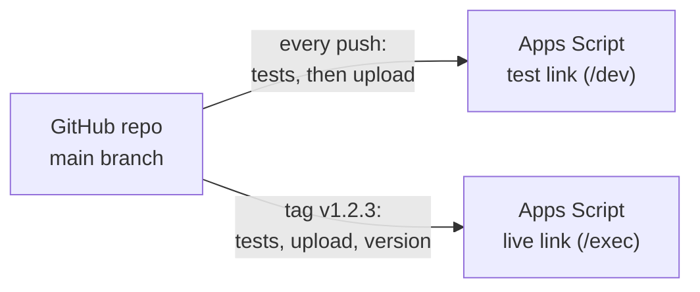

# Managing and Deploying the Code

*For Work Request Tracker v1.7.1.*

The GitHub repository is the single source of truth. Code is never pasted into the Apps Script editor. Every change is committed to the repo, and GitHub Actions sends it to Google Apps Script using Google's command-line tool, **clasp**.



| You do this | What happens | Who sees it |
| --- | --- | --- |
| Push to `main` | Tests run, then the code uploads to Apps Script | Only the **test link** (`/dev`), which only you can open |
| Push a tag such as `v1.8.0` | Tests run, the code uploads, a numbered version is saved, and the live web app moves to it | Everyone using the **live link** (`/exec`). The URL never changes |
| Actions tab > **Deploy to Apps Script** > **Run workflow** | The same, chosen by hand: `push` or `release` | As above |

If a test or the version check fails, nothing is uploaded.

## Rules that keep it safe

- **Edit in the repo, never in the Apps Script editor.** Each upload replaces the files in Apps Script, so an edit made there is overwritten. If you ever do change something there, copy it into the repo first.
- **Every change gets a version.** Run `npm run bump -- 1.8.0`, fill in the CHANGELOG entry, and commit. The build fails if any file is out of step.
- **Test on `/dev`, release to `/exec`.** Pushing to `main` never touches the live link. Only a tag does.
- **Credentials stay out of the repo.** `.clasp.json`, `.clasprc.json` and `.deploy.json` are in `.gitignore`. In GitHub they live only as encrypted repository secrets.

## One-time setup (about 15 minutes, all in the browser)

Nothing needs to be installed on your computer. Step 5 uses a GitHub Codespace, a temporary computer in the browser.

### 1. Turn on the Apps Script API
Go to [script.google.com/home/usersettings](https://script.google.com/home/usersettings) and switch **Google Apps Script API** to **On**. Use the same Google account that owns the tracker's Sheet.

### 2. Copy the Script ID
In the Sheet, open **Extensions > Apps Script**. Click **Project Settings** (gear icon). Under **IDs**, copy the **Script ID**.

### 3. Copy the Deployment ID
In the Apps Script editor, click **Deploy > Manage deployments**. Select your web app deployment and copy its **Deployment ID** (it starts with `AKfy`). If there isn't one yet, create it first: **Deploy > New deployment > Web app**, execute as **Me**, access **Anyone**.

### 4. Add the two IDs as repository secrets
In the GitHub repo: **Settings > Secrets and variables > Actions > New repository secret**. Add:
- `SCRIPT_ID`: the Script ID from step 2
- `DEPLOYMENT_ID`: the Deployment ID from step 3

### 5. Sign clasp in to Google and save the credentials as a secret
1. In the repo, click **Code > Codespaces > Create codespace on main**. A browser editor opens with a terminal at the bottom.
2. In the terminal, run:
   ```
   npm ci
   npm run login
   ```
3. clasp prints a long Google link. Open it, sign in with the account that owns the Sheet, and click **Allow**.
4. The browser lands on a page that won't load (its address starts with `http://localhost`). That's expected. **Copy the full address** from the address bar, paste it into the terminal, and press Enter. You should see **"You are logged in as ..."**.
5. Show the saved credentials: `cat ~/.clasprc.json`. Copy the entire output.
6. Back in **Settings > Secrets and variables > Actions**, add `CLASPRC_JSON` and paste it.
7. Clean up: `rm ~/.clasprc.json`, then close the tab and delete the codespace (**Code > Codespaces > ... > Delete**).

### 6. Test the pipeline
In the repo, open **Actions > Deploy to Apps Script > Run workflow**, choose **push**, and run it.

**Validate:**
- [ ] The run finishes green and the log ends with "The test (/dev) link now runs v..."
- [ ] Refresh the Apps Script editor: the files match the repo
- [ ] Your test link shows the same version at the bottom of the page

Then run it again with **release**.

**Validate:**
- [ ] The log ends with "The live (/exec) link now runs v..."
- [ ] **Deploy > Manage deployments** shows a new version with that description
- [ ] The live link shows the new version and still works with existing links

## Everyday workflow

1. Make the change in the repo (in a branch, a codespace, or with Claude).
2. Move the version: `npm run bump -- 1.8.0`, then describe the change in `CHANGELOG.md`.
3. Run `npm test`.
4. Commit and push to `main`. Test on your `/dev` link.
5. When it's right, release it:
   ```
   git tag v1.8.0
   git push origin v1.8.0
   ```
   Or create a GitHub release with tag `v1.8.0`. The live link updates within a minute or two.

**Rolling back:** in the Apps Script editor, **Deploy > Manage deployments > Edit**, choose the earlier version, and **Deploy**. Then fix forward in the repo.

## Commands

| Command | What it does |
| --- | --- |
| `npm test` | Version check, then the server flow tests (no Google account needed) |
| `npm run bump -- 1.8.0` | Moves every file to a new version and adds a CHANGELOG entry |
| `npm run push` | Uploads to Apps Script (`/dev` only) |
| `npm run release` | Uploads, saves a version and updates the live `/exec` deployment |
| `npm run watch` | Uploads automatically each time you save a file (local development) |
| `npm run login` | Signs clasp in to Google |

`push`, `release` and `watch` read `SCRIPT_ID` and `DEPLOYMENT_ID` from environment variables or from local files: `.clasp.json` (`{"scriptId":"...","rootDir":"."}`) and `.deploy.json` (`{"deploymentId":"..."}`). These files are ignored by git.

## Working on your own computer (optional)

Install Node.js 20 or later ([nodejs.org](https://nodejs.org), LTS), clone the repo, then run `npm ci`, `npm run login` and create the two files above. The same commands work locally. GitHub Actions remains the normal way to deploy, so the repo always matches what is live.

## Security notes

- **The `CLASPRC_JSON` secret can manage your Apps Script projects.** It is stored encrypted by GitHub and is only available to workflows in this repo, never to forks or pull requests from forks. To revoke it, remove "clasp" at [myaccount.google.com/permissions](https://myaccount.google.com/permissions), and delete the secret.
- **When the secret stops working.** It ends if you change your Google password or revoke access. Repeat step 5.
- **Anyone with push access** can deploy. Keep collaborators to people you trust, or protect `main` and tags under **Settings > Rules**.
